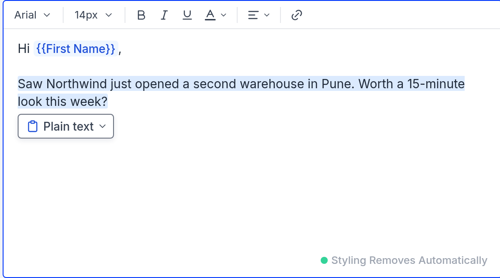
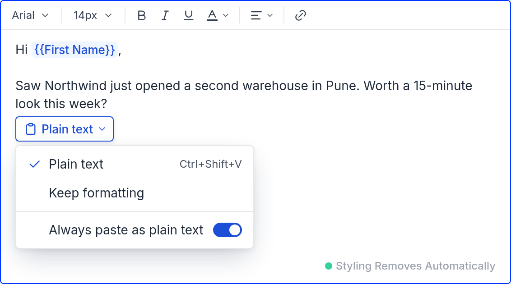
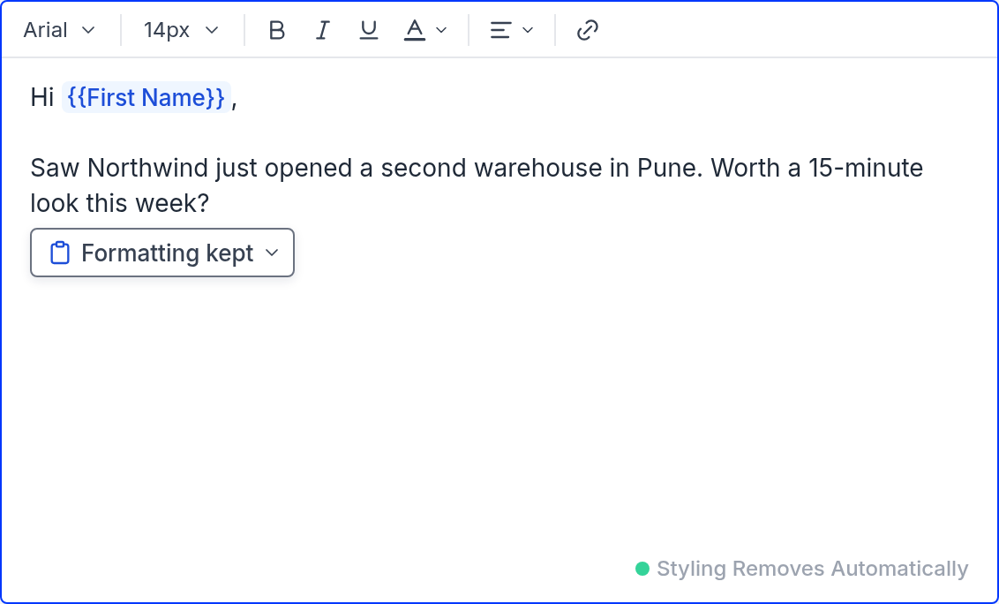
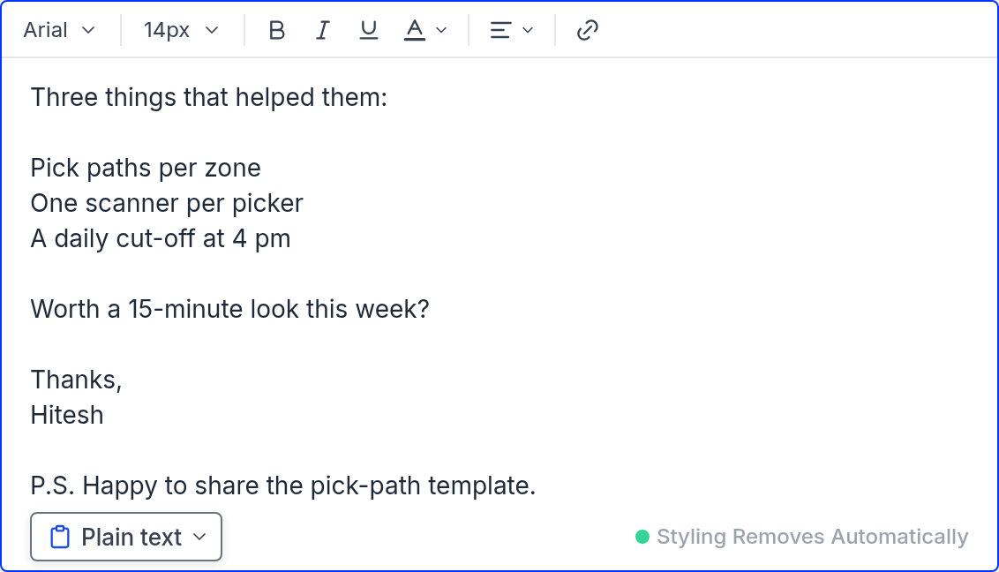

# PRD – Paste as plain text

**Design of record:** [clickable prototype](prototype/index.html) · **Status:** Ready for review

---

## 1. Problem

- Pastes from Word, Google Docs and web pages bring invisible markup into the step editor: 38.4 KB of HTML for 1.1 KB of text in a one-paragraph Word paste (measured, Sep 2026). The editor's own paste cleanup is off ([editor.tsx L1374](https://github.com/saleshandy/saleshandy-webui/blob/aeda4e3654fd76c54725fd676463c3694a35eed3/src/shared/editor/editor.tsx#L1374)).
- Under Remove Styling Automatically, a styled paste shows the "Styling detected" bar, and its Keep button turns Remove Styling off for the whole sequence ([email-modal.tsx L1116–1197](https://github.com/saleshandy/saleshandy-webui/blob/c9feb458b3d4d35918d4196d2b265061fe3f9ece/src/components/sequence/shared/modals/email-modal/email-modal.tsx#L1116-L1197)).

---

## 2. What we're building

1. **Pastes land as plain text by default**, exactly like Ctrl+Shift+V: paragraphs and line breaks stay; links, bold, lists, images and fonts go. Hidden markup never gets in.
2. **A paste chip** at the end of every paste that could have landed differently switches it between Plain text and Keep formatting.
3. **A per-user switch, "Always paste as plain text"**, default On, in the editor's "•••" menu and in the chip.
4. **With the switch off, a paste follows the sequence's Safety Settings as they are today:**
    - Remove Styling Automatically: it lands as it will be sent;
    - Text only email: plain text;
    - Neither: as copied, minus hidden markup.
5. **On a paste, the chip replaces the Styling detected bar.** Styling added from the toolbar still shows today's bar.
6. **Scope:** the email draft in the sequence step editor: its body, subject line and spintax variants.

**Always true:**

- The chip never takes the cursor.
- No paste changes a sequence setting.
- The chip never touches text outside the paste.
- No stored value changes; there is no migration.

---

## 3. Surfaces

### 3.1 Paste in the email body, and the paste chip

Applies to every paste or drop into a sequence step's email body.

**What lands:**

| Switch | Remove Styling Automatically (default) | Neither | Text only email |
|---|---|---|---|
| **On** (default) | Plain text. Chip: "Plain text" | Plain text. Chip: "Plain text" | Plain text, no chip |
| **Off** | As Remove Styling will send it: bold, italic, links, lists, images and tables kept; fonts, sizes, colours, highlight, underline, strikethrough, alignment and headings removed. Chip: "Formatting kept" | As copied, minus hidden markup. Chip: "Formatting kept" | Plain text, no chip |

- **Hidden markup** changes nothing visible: Word and Docs classes, comments, empty spans, and font declarations equal to the editor's own. It is always removed, in every cell.
- **The chip shows only when Plain text and Keep formatting would look different** for this paste, meaning a link, bold, a list, an image, a colour or a font differs.
- **No chip** for:
    - a plain-text source (Notepad);
    - a paste copied inside Saleshandy;
    - Ctrl+Shift+V or Cmd+Shift+V;
    - Text only email;
    - a paste that looks the same either way (a name from LinkedIn).
- Literal `{{First Name}}` and `{spin}…{endspin}` in pasted text become chips, whichever way it lands.

**The chip:**

| State | Label | Menu |
|---|---|---|
| Landed plain | Clipboard icon · **Plain text ▾** | ✓ Plain text (hint Ctrl+Shift+V, ⇧⌘V on a Mac) · Keep formatting · divider · Always paste as plain text (switch) |
| Landed formatted | Clipboard icon · **Formatting kept ▾** | Plain text · ✓ Keep formatting · divider · Always paste as plain text (switch) |

- Picking the other option rewrites only this paste. The user can switch back and forth as often as wanted.
- The switch changes every future paste, not this one.

**Where it sits:**

| Rule | Requirement |
|---|---|
| Anchor | 4px below the last pasted line, left edge where the paste ends |
| Sideways | Stays at least 12px inside the editor's edges |
| Room below | If the paste ends near the bottom, the editor scrolls until the chip fits below it. The chip never covers the pasted text; it may cover the next line while open |
| Scrolled away | Pinned to the top edge of the body, or to its bottom edge beside the format badge (just above the badge when the editor is too narrow for both). It returns to the paste when the paste is back in view |
| Switching while pinned | The editor scrolls back to the paste and the tint replays |
| Layers | Above the email text; below the toolbar, the subject line, the badge, menus and dialogs |
| Menu | Opens below the chip, or above it when there is no room, and stays inside the editor |

**How it is noticed:**

- On entrance it rises in over 180ms with one soft blue ring.
- The pasted text gets a light blue tint that fades over 1.2s, and the tint replays after every switch.
- At rest it has a white fill, a grey-500 border (4.8:1 on white) and a blue clipboard icon.
- With reduced motion on: no rise and no ring; the tint still shows.

**Keyboard and screen readers:**

- Ctrl pressed and released on its own opens the menu with the ticked option focused. Tab from the text also reaches the chip.
- In the menu: arrow keys move, Home and End jump, Enter picks, Esc closes and returns the cursor to the text, and Tab closes.
- A polite live announcement, once per paste: "Pasted as plain text. Press Ctrl for paste options." For a formatted paste the first sentence is "Pasted with formatting." Each switch is announced: "Switched to plain text." or "Switched to keep formatting."

**Closes on:** a key that changes the text (typing, Delete, Backspace, Enter), Esc, the next paste, Ctrl+Z, or a click in the text outside the paste. A click inside the paste keeps it. Ctrl+Z works as normal and removes the paste.

**Explicitly out of scope:** pasted image files (screenshots) behave as today.

**Acceptance criteria**

| ID | Case | Expected | P |
|---|---|---|---|
| P-1 | Switch on, Remove Styling: paste a Word draft with bold, a link, a list and a coloured font | Body holds plain text with paragraphs; no `<b>`, `<a>`, list, `style` or Word class; chip "Plain text" | P0 |
| P-2 | Switch on: paste a name copied from LinkedIn | No chip; no hidden markup in the body | P0 |
| P-3 | Switch off, Remove Styling: paste the P-1 draft | Bold, link and list kept; no `style`, font or colour; chip "Formatting kept" | P0 |
| P-4 | Switch off, Neither: paste the P-1 draft | Visible formatting kept; no Word classes or comments; chip "Formatting kept" | P0 |
| P-5 | Text only email: paste the P-1 draft with the switch on, then off | Plain text both times; no chip either time | P0 |
| P-6 | Paste from Notepad | Lands as is; no chip | P0 |
| P-7 | Copy from another step or template inside Saleshandy, then paste | Lands as copied, merge-tag and spintax chips kept; no paste chip | P0 |
| P-8 | Ctrl+Shift+V (Cmd+Shift+V) with the switch off | Plain text; no chip | P0 |
| P-9 | Paste literal `{{First Name}}` and <code>{spin}a&#124;b{endspin}</code> | Both become chips | P0 |
| P-10 | Paste, then press an arrow key, then Tab | The chip stays both times | P0 |
| P-11 | Paste, then type one character | The chip closes; the cursor never left the body | P0 |
| P-12 | Paste twice | One chip, for the second paste | P1 |
| P-13 | Drag and drop the P-1 draft | Same as P-1 | P1 |
| **P-F1** | P-1, then chip → **Keep formatting** | Body holds what Remove Styling sends (bold, link and list back; no fonts or colours); text outside the paste byte-identical to before the paste; chip reads "Formatting kept" | P0 · **sign off by name, owner: QA lead (name to confirm)** |
| P-F2 | P-F1, then chip → Plain text | Back to the P-1 result exactly | P0 |
| P-F3 | Switch on, Neither: P-1, then Keep formatting | The paste as copied, minus hidden markup | P0 |
| P-F4 | P-1, then Ctrl+Z | The paste is removed; body byte-identical to before the paste; no chip | P0 |
| P-F5 | Chip → switch "Always paste as plain text" off | This paste is unchanged; the next paste follows the Off row; after a reload the "•••" menu reads Off (read back: menu state and `/user/meta`) | P0 |
| C-1 | Paste near the bottom of the editor | The editor scrolls; the chip sits 4px under the paste end and covers no pasted text | P0 |
| C-2 | Paste ending near the right edge | The chip stays 12px inside the edge | P1 |
| C-3 | Paste, then scroll the paste out of view, both ways | The chip pins to the top edge, then to the bottom edge beside the badge; it returns when the paste is back in view | P0 |
| C-4 | Pinned chip → Keep formatting | The editor scrolls to the paste; the tint replays | P0 |
| C-5 | Click in the text outside the paste, then (after a new paste) inside it | The chip closes the first time and stays the second | P1 |
| C-6 | Paste, then press and release Ctrl alone | The menu opens with the ticked option focused; arrow keys, Enter and Esc behave as above | P0 |
| C-7 | Screen reader on: paste the P-1 draft, then switch | "Pasted as plain text. Press Ctrl for paste options." once, then "Switched to keep formatting." | P0 |
| C-8 | Reduced motion on: paste | No rise or ring; the tint shows | P2 |
| C-9 | A Mac | The menu hint reads ⇧⌘V | P2 |

### 3.2 The switch in the editor's "•••" menu

- A toggle button at the end of the "•••" menu, in its own group, labelled with a clipboard icon. Pressed means On. Tooltip: "Always paste as plain text: On" or "…: Off".
- The default is On for every user, new and existing.
- It saves when switched, for that user, across devices. It applies from the next paste.
- It is the same setting as the switch in the chip. It is never greyed out.

| ID | Case | Expected | P |
|---|---|---|---|
| M-1 | New user opens the "•••" menu | Toggle pressed; tooltip "Always paste as plain text: On" | P0 |
| M-2 | Turn it off, reload, open another sequence's step | Still off (read back: menu state and `/user/meta`) | P0 |
| M-3 | User A turns it off | User B in the same account is still on | P0 |
| M-4 | Turn it off in the chip | The "•••" menu shows Off at once | P0 |

### 3.3 Subject line and spintax variants

- **Subject:** a paste is always plain text, on one line, with no chip, whatever the switch.
- **Spintax variant field:** a paste is always plain text, with no chip. The field shows "Variants are saved as plain text." under the inputs.

| ID | Case | Expected | P |
|---|---|---|---|
| F-1 | Paste the P-1 draft into the subject, switch off | One line of plain text; no chip | P0 |
| F-2 | Paste the P-1 draft into a variant, switch off | Plain text; no chip; the note visible | P0 |

---

## 4. Out of scope

These stay exactly as they are today:

- Safety Settings;
- the format badge and its pop-up;
- the toolbar, including the Styling detected bar for styling added from it;
- paste in templates, Unified Inbox replies, task notes and the signature editor.

---

## 5. Cross-cutting

**Chip integrity, release blocker:**

| ID | Case | Expected | P |
|---|---|---|---|
| X-1 | Copy and paste each of the five merge-tag and spintax chip types within the body, body to variant, variant to body, and between steps | Every chip survives as a chip | P0 |
| X-2 | Paste over a selection that contains chips | The chips are removed cleanly; no broken fragments | P0 |
| X-3 | Save and reload after X-1 | Every chip is still a chip | P0 |
| X-4 | Paste malformed spintax (<code>{spin}a&#124;b</code> with no end) | Stays literal text; no partial chip | P0 |

**Keyboard:**

| Key | Behaviour |
|---|---|
| Ctrl+Shift+V / Cmd+Shift+V | Always plain text, never a chip, in every field |
| Ctrl+Z / Cmd+Z | Standard. After a paste it removes the paste and the chip |
| Ctrl alone | Opens the chip's menu when a chip is showing; nothing otherwise |
| Esc | Closes the chip's menu, then the chip; never moves the cursor |

---

## 6. Implementation notes

- **The chip sits on top of an editor in an iframe.** It must be positioned at the paste end and pinned to the body's edges while scrolling (§3.1). **Resolve before estimation:** how the chip tracks the paste end inside the TinyMCE iframe, and that "Ctrl alone" is free in the editor and the browsers we support.
- **"Lands as Remove Styling will send it" must match the send step.** The send step's cleanup is [parse-content.ts](https://github.com/saleshandy/saleshandy-email-composer/blob/37b1fb6b11691d5d8ffdb50045fa9bcc378e7432/src/common/utils/parse-content.ts), applied at [app.service.ts L1397](https://github.com/saleshandy/saleshandy-email-composer/blob/37b1fb6b11691d5d8ffdb50045fa9bcc378e7432/src/app.service.ts#L1397-L1405). Paste needs identical output, held to one shared test set. **Resolve before estimation:** one shared implementation, or two with shared tests.
- **The step editor shares one component** with the signature, template, inbox-reply and task-note editors (code search). The new paste rules must be switched on for the sequence step editor only.
- **The per-user switch:** `/user/meta` returns `pasteAsPlainText` (default on) per account and admin-only in [edge#11339](https://github.com/saleshandy/saleshandy-edge/pull/11339). It must be stored per user and changeable by the user.
- **Resolve before estimation:**
    1. With the editor's built-in paste cleanup on, real Word, Google Docs and Gmail pastes lose hidden markup but keep visible formatting, for Keep formatting and switch-off. Assumed, not tested.
    2. The "would look different" check behind the chip is reliable on the same samples. Assumed, not tested.

---

## 7. Measurement

**Privacy:** never log pasted content, email text or URLs. Log only the kinds of formatting removed and the sizes.

| Event | Fires when | Properties |
|---|---|---|
| `paste_landed` | Any paste or drop into a step body | safety_setting, switch, chip_shown, landed (plain, formatted), removed_kinds (link, bold, list, image, colour, font), html_kb, kept_kb |
| `paste_chip_opened` | The chip's menu opens | via (click, ctrl, tab), pinned |
| `paste_chip_switched` | Plain text or Keep formatting is picked | to, pinned, seconds_since_paste |
| `paste_switch_changed` | The switch changes | to, from (menu, chip) |

**Leading indicators**, read from day 1, decide by day 14:

| Metric | Definition | Healthy | Investigate |
|---|---|---|---|
| **Keep-formatting rate (most important)** | switches to Keep formatting ÷ chips shown with the switch on | < 30% (target; assumed, no baseline) | > 50%: plain is wrong too often |
| Chip rate | chips shown ÷ pastes | < 50% (target; assumed) | > 70%: the "looks different" check is too loose |
| Keyboard opens | opens via ctrl or tab ÷ all opens | – (read only) | 0 after 2 weeks: check the shortcut works |

**Lagging indicators**, day 30 and day 90:

- Users with the switch off ÷ users who pasted.
- Tickets mentioning pasted formatting or lost links.
- Sequences whose Remove Styling setting was turned off within a minute of a paste: target 0.

**Guardrails:**

| Guardrail | Threshold | Action |
|---|---|---|
| Chip integrity | Any X-1 to X-4 failure in production | Halt rollout |
| Text outside a paste changed by a switch | Any confirmed case | Roll back |
| Formatting or link tickets | 2× the 4-week pre-launch weekly average (target) | Halt rollout |

**Success criteria**, judged at day 30 at 100%:
1. **Non-negotiable:** no chip-integrity failures, and no text outside a paste changed.
2. **Non-negotiable:** no sequence setting changed by a paste.
3. **Iterate, don't revert:** the keep-formatting rate stays under 30%.

Instrumentation ships with the feature.

---

## 8. Rollout

Every user with the feature gets the same default.

| Stage | Who | Gate |
|---|---|---|
| 1 | Internal accounts | Every P0 passes; **P-F1 signed off by name** |
| 2 | 5% of accounts | No guardrail breached for one week |
| 3 | 100% | No guardrail breached at 5% |

No stage starts before the "resolve before estimation" items in §6 are settled. The help article on pasting is updated before stage 3.

---

## 9. Open questions

| # | Question | Recommendation | Blocking |
|---|---|---|---|
| 1 | Does Dhruv agree that, with the switch off, pastes follow today's Safety Settings? | Confirm before dev review | Yes |
| 2 | Is "Ctrl alone" free in TinyMCE and our browsers? | If not, Alt+Ctrl+V opens the menu; Tab still reaches the chip | Yes |

---

## 10. Owners

- **Priority:** P1 (assumed; Hitesh to confirm). **Target:** after estimation. **Release gate:** §8 stage 1.
- Dev: Sunny (to confirm) · QA lead for the P-F1 sign-off: name to confirm · Tech review: Rajat · PM: Hitesh · Help article: CS, name to confirm.

---

## Appendix – reference index

- **Design of record:** [the clickable prototype](prototype/index.html). Section 2 is the live paste simulator; section 3 has the chip states and the placement rules; section 4 shows what lands under each setting; section 5 covers the subject and spintax. Production Saleshandy webui is the visual source.
- **Code read:** webui `aeda4e3` (16 Oct) and `c9feb45` (12 Oct); email-composer `37b1fb6` (12 Oct). Links are inline above.
- **Data:** Metabase db 2, run 12 Oct 2026.
