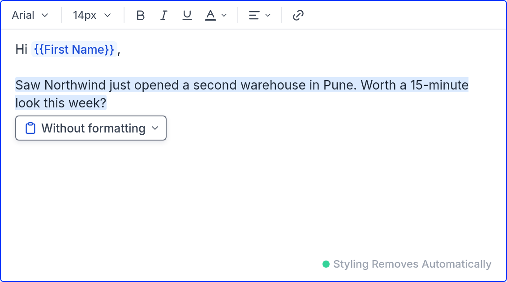
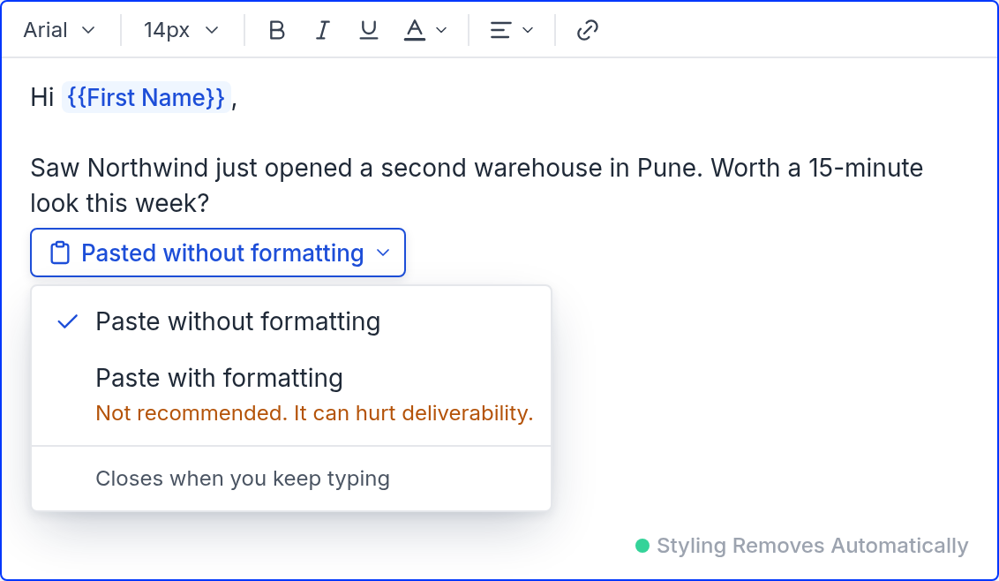
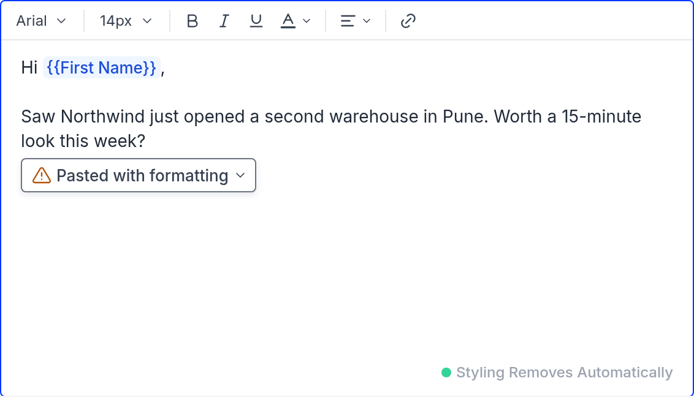
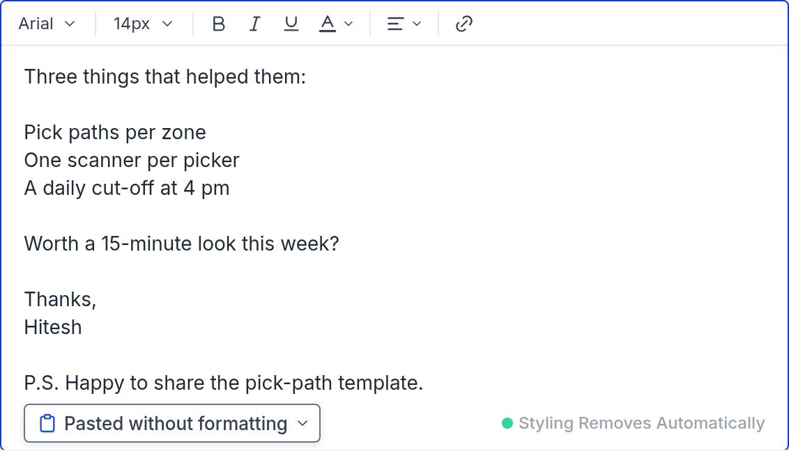

# PRD – Paste without formatting

**Design of record:** [clickable prototype](prototype/index.html) · **Status:** Ready for review

---

## 1. Problem

- Pastes from Word, Google Docs and web pages bring invisible markup into the step editor: 38.4 KB of HTML for 1.1 KB of text in a one-paragraph Word paste (measured, Sep 2026). The editor's own paste cleanup is off ([editor.tsx L1374](https://github.com/saleshandy/saleshandy-webui/blob/aeda4e3654fd76c54725fd676463c3694a35eed3/src/shared/editor/editor.tsx#L1374)).
- Under Remove Styling Automatically, a styled paste shows the "Styling detected" bar, and its Keep button turns Remove Styling off for the whole sequence ([email-modal.tsx L1116–1197](https://github.com/saleshandy/saleshandy-webui/blob/c9feb458b3d4d35918d4196d2b265061fe3f9ece/src/components/sequence/shared/modals/email-modal/email-modal.tsx#L1116-L1197)).

---

## 2. What we're building

1. **Pastes land without formatting by default**, exactly like Ctrl+Shift+V. **Without formatting** means the words and line breaks only: what is stored is identical to typing the same text by hand, with no styles, attributes, links, bold, lists, images or other tags. Hidden markup never gets in.
2. **A paste chip** at the end of every paste that could have landed differently. It reads "Pasted without formatting"; its menu's "Paste with formatting" switches that one paste.
3. **"Paste with formatting" is marked not recommended:** "Not recommended. It can hurt deliverability." It never blocks the pick.
4. **"Paste with formatting" brings back what the sequence's Safety Settings allow today:**
    - Remove Styling Automatically: what it will send;
    - Neither: as copied, minus hidden markup;
    - Text only email: no chip, so nothing to bring back.
5. **On a paste, the chip replaces the Styling detected bar.** Styling added from the toolbar still shows today's bar.
6. **There is no setting.** Every paste lands without formatting, for every user. Nothing in the chip, the "•••" menu or anywhere else changes that.
7. **Scope:** the email draft in the sequence step editor: its body, subject line and spintax variants.

**Always true:**

- The chip never takes the cursor.
- No paste changes a sequence setting.
- The chip never touches text outside the paste.
- No stored value changes; there is no migration.

---

## 3. Surfaces

### 3.1 Paste in the email body, and the paste chip

Applies to every paste or drop into a sequence step's email body.

**What lands:**

| Safety Settings | Lands | After "Paste with formatting" |
|---|---|---|
| **Remove Styling Automatically** (default) | Without formatting. Chip: "Pasted without formatting" | As Remove Styling will send it: bold, italic, links, lists, images and tables kept; fonts, sizes, colours, highlight, underline, strikethrough, alignment and headings removed |
| **Neither** | Without formatting. Chip: "Pasted without formatting" | As copied, minus hidden markup |
| **Text only email** | Without formatting, no chip | – |

- **Hidden markup** changes nothing visible: Word and Docs classes, comments, empty spans, and font declarations equal to the editor's own. It is always removed, in every cell.
- **The chip shows only when the two options would look different** for this paste, meaning a link, bold, a list, an image, a colour or a font differs.
- **No chip** for:
    - a source with no formatting (Notepad);
    - a paste copied inside Saleshandy;
    - Ctrl+Shift+V or Cmd+Shift+V;
    - Text only email;
    - a paste that looks the same either way (a name from LinkedIn).
- Literal `{{First Name}}` and `{spin}…{endspin}` in pasted text become chips, whichever way it lands.

**The chip:**

| State | Label | Menu |
|---|---|---|
| Landed (always) | Clipboard icon · **Pasted without formatting ▾** | ✓ Paste without formatting · Paste with formatting, with "Not recommended. It can hurt deliverability." under it in amber · divider · "Closes when you keep typing" |
| After "Paste with formatting" | Amber warning icon · **Pasted with formatting ▾** · tooltip "Not recommended. It can hurt deliverability." | Paste without formatting · ✓ Paste with formatting (same amber line) · divider · "Closes when you keep typing" |

- The chip says what happened ("Pasted …"); its menu says what to do in the same words ("Paste …").
- Picking the other option rewrites only this paste. The user can switch back and forth as often as wanted.
- **There is no close button.** The menu's last line, under a divider, says "Closes when you keep typing", every time it opens.

**Where it sits:**

| Rule | Requirement |
|---|---|
| Anchor | 4px below the last pasted line, left edge where the paste ends |
| Sideways | Stays at least 12px inside the editor's edges |
| Room below | If the paste ends near the bottom, the editor scrolls until the chip fits below it. The chip never covers the pasted text; it may cover the next line while open |
| Scrolled away | Pinned to the top edge of the body, or to its bottom edge beside the format badge (just above the badge when the editor is too narrow for both). It returns to the paste when the paste is back in view |
| Switching while pinned | The editor scrolls back to the paste and the tint replays |
| Layers | Above the email text; below the toolbar, the subject line, the badge, menus and dialogs |
| Menu | Opens below the chip, or above it when there is no room, and stays inside the editor |

**How it is noticed:**

- On entrance it rises in over 180ms with one soft blue ring.
- The pasted text gets a light blue tint that fades over 1.2s, and the tint replays after every switch.
- At rest it has a white fill, a grey-500 border (4.8:1 on white) and a blue clipboard icon.
- With reduced motion on: no rise and no ring; the tint still shows.

**Keyboard and screen readers:**

- Ctrl pressed and released on its own opens the menu with the ticked option focused. Tab from the text also reaches the chip.
- In the menu: arrow keys move, Home and End jump, Enter picks, Esc closes and returns the cursor to the text, and Tab closes.
- A polite live announcement, once per paste: "Pasted without formatting. Press Ctrl for paste options." It ends "It closes when you keep typing." Each switch is announced: "Switched to pasted without formatting." or "Switched to pasted with formatting. Not recommended. It can hurt deliverability."

**Closes on:** a key that changes the text (typing, Delete, Backspace, Enter), Esc, the next paste, Ctrl+Z, or a click in the text outside the paste. A click inside the paste keeps it. Ctrl+Z works as normal and removes the paste.

**Explicitly out of scope:** pasted image files (screenshots) behave as today.

**Acceptance criteria**

| ID | Case | Expected | P |
|---|---|---|---|
| P-1 | Remove Styling: paste a Word draft with bold, a link, a list and a coloured font | Body holds only the words and paragraphs; no `<b>`, `<a>`, list, `style` or Word class; chip "Pasted without formatting" | P0 |
| P-2 | Paste a name copied from LinkedIn | No chip; no hidden markup in the body | P0 |
| P-3 | P-1, then open the chip | "Paste with formatting" shows "Not recommended. It can hurt deliverability." under it, in amber | P0 |
| P-4 | Look for a paste setting in the chip, the "•••" menu and the user's settings | None exists; every user's paste lands as in P-1 | P0 |
| P-5 | Text only email: paste the P-1 draft | Without formatting; no chip | P0 |
| P-6 | Paste from Notepad | Lands as is; no chip | P0 |
| P-7 | Copy from another step or template inside Saleshandy, then paste | Lands as copied, merge-tag and spintax chips kept; no paste chip | P0 |
| P-8 | Ctrl+Shift+V (Cmd+Shift+V) | Without formatting; no chip | P0 |
| P-9 | Paste literal `{{First Name}}` and <code>{spin}a&#124;b{endspin}</code> | Both become chips | P0 |
| P-10 | Paste, then press an arrow key, then Tab | The chip stays both times | P0 |
| P-11 | Paste, then type one character | The chip closes; the cursor never left the body | P0 |
| P-12 | Paste twice | One chip, for the second paste | P1 |
| P-13 | Drag and drop the P-1 draft | Same as P-1 | P1 |
| P-14 | P-1; then in a new email, type the same lines by hand | The stored HTML of the two bodies is identical | P0 |
| **P-F1** | P-1, then chip → **Paste with formatting** | Body holds what Remove Styling sends (bold, link and list back; no fonts or colours); text outside the paste byte-identical to before the paste; chip reads "Pasted with formatting" with the amber warning icon; its tooltip reads "Not recommended. It can hurt deliverability." | P0 · **sign off by name, owner: QA lead (name to confirm)** |
| P-F2 | P-F1, then chip → Paste without formatting | Back to the P-1 result exactly | P0 |
| P-F3 | Neither: P-1, then Paste with formatting | The paste as copied, minus hidden markup | P0 |
| P-F4 | P-1, then Ctrl+Z | The paste is removed; body byte-identical to before the paste; no chip | P0 |
| C-1 | Paste near the bottom of the editor | The editor scrolls; the chip sits 4px under the paste end and covers no pasted text | P0 |
| C-2 | Paste ending near the right edge | The chip stays 12px inside the edge | P1 |
| C-3 | Paste, then scroll the paste out of view, both ways | The chip pins to the top edge, then to the bottom edge beside the badge; it returns when the paste is back in view | P0 |
| C-4 | Pinned chip → Paste with formatting | The editor scrolls to the paste; the tint replays | P0 |
| C-5 | Click in the text outside the paste, then (after a new paste) inside it | The chip closes the first time and stays the second | P1 |
| C-6 | Paste, then press and release Ctrl alone | The menu opens with the ticked option focused; arrow keys, Enter and Esc behave as above | P0 |
| C-7 | Screen reader on: paste the P-1 draft, then switch | "Pasted without formatting. Press Ctrl for paste options." once, then "Switched to pasted with formatting. Not recommended. It can hurt deliverability." | P0 |
| C-8 | Reduced motion on: paste | No rise or ring; the tint shows | P2 |
| C-9 | Open the chip's menu | Its last line, under a divider, reads "Closes when you keep typing"; the chip has no close button | P1 |

### 3.2 Subject line and spintax variants

- **Subject:** a paste is always without formatting, on one line, with no chip.
- **Spintax variant field:** a paste is always without formatting, with no chip. The field shows "Only text is allowed in spintax." under the inputs.

| ID | Case | Expected | P |
|---|---|---|---|
| F-1 | Paste the P-1 draft into the subject | One line, without formatting; no chip | P0 |
| F-2 | Paste the P-1 draft into a variant | Without formatting; no chip; "Only text is allowed in spintax." visible | P0 |

---

## 4. Cross-cutting

**Chip integrity, release blocker:**

| ID | Case | Expected | P |
|---|---|---|---|
| X-1 | Copy and paste each of the five merge-tag and spintax chip types within the body, body to variant, variant to body, and between steps | Every chip survives as a chip | P0 |
| X-2 | Paste over a selection that contains chips | The chips are removed cleanly; no broken fragments | P0 |
| X-3 | Save and reload after X-1 | Every chip is still a chip | P0 |
| X-4 | Paste malformed spintax (<code>{spin}a&#124;b</code> with no end) | Stays literal text; no partial chip | P0 |

**Keyboard:**

| Key | Behaviour |
|---|---|
| Ctrl+Shift+V / Cmd+Shift+V | Always without formatting, never a chip, in every field |
| Ctrl+Z / Cmd+Z | Standard. After a paste it removes the paste and the chip |
| Ctrl alone | Opens the chip's menu when a chip is showing; nothing otherwise |
| Esc | Closes the chip's menu, then the chip; never moves the cursor |

---

## 5. Implementation notes

- **The chip sits on top of an editor in an iframe.** It must be positioned at the paste end and pinned to the body's edges while scrolling (§3.1). **Resolve before estimation:** how the chip tracks the paste end inside the TinyMCE iframe, and that "Ctrl alone" is free in the editor and the browsers we support.
- **"Lands as Remove Styling will send it" must match the send step.** The send step's cleanup is [parse-content.ts](https://github.com/saleshandy/saleshandy-email-composer/blob/37b1fb6b11691d5d8ffdb50045fa9bcc378e7432/src/common/utils/parse-content.ts), applied at [app.service.ts L1397](https://github.com/saleshandy/saleshandy-email-composer/blob/37b1fb6b11691d5d8ffdb50045fa9bcc378e7432/src/app.service.ts#L1397-L1405). Paste needs identical output, held to one shared test set. **Resolve before estimation:** one shared implementation, or two with shared tests.
- **The step editor shares one component** with the signature, template, inbox-reply and task-note editors (code search). The new paste rules must be switched on for the sequence step editor only.
- **No paste setting is stored.** The `pasteAsPlainText` setting added in [edge#11339](https://github.com/saleshandy/saleshandy-edge/pull/11339) is not used by this feature.
- **Resolve before estimation:**
    1. With the editor's built-in paste cleanup on, real Word, Google Docs and Gmail pastes lose hidden markup but keep visible formatting, for Paste with formatting. Assumed, not tested.
    2. The "would look different" check behind the chip is reliable on the same samples. Assumed, not tested.

---

## 6. Measurement

**Privacy:** never log pasted content, email text or URLs. Log only the kinds of formatting removed and the sizes.

| Event | Fires when | Properties |
|---|---|---|
| `paste_landed` | Any paste or drop into a step body | safety_setting, chip_shown, landed (without_formatting, with_formatting), removed_kinds (link, bold, list, image, colour, font), html_kb, kept_kb |
| `paste_chip_opened` | The chip's menu opens | via (click, ctrl, tab), pinned |
| `paste_chip_switched` | Paste without formatting or Paste with formatting is picked | to, pinned, seconds_since_paste |

**Leading indicators**, read from day 1, decide by day 14:

| Metric | Definition | Healthy | Investigate |
|---|---|---|---|
| **With-formatting rate (most important)** | switches to Paste with formatting ÷ chips shown | < 30% (target; assumed, no baseline) | > 50%: removing formatting is wrong too often |
| Chip rate | chips shown ÷ pastes | < 50% (target; assumed) | > 70%: the "looks different" check is too loose |
| Keyboard opens | opens via ctrl or tab ÷ all opens | – (read only) | 0 after 2 weeks: check the shortcut works |

**Lagging indicators**, day 30 and day 90:

- Tickets mentioning pasted formatting or lost links.
- Sequences whose Remove Styling setting was turned off within a minute of a paste: target 0.

**Guardrails:**

| Guardrail | Threshold | Action |
|---|---|---|
| Chip integrity | Any X-1 to X-4 failure in production | Halt rollout |
| Text outside a paste changed by a switch | Any confirmed case | Roll back |
| Formatting or link tickets | 2× the 4-week pre-launch weekly average (target) | Halt rollout |

**Success criteria**, judged at day 30 at 100%:
1. **Non-negotiable:** no chip-integrity failures, and no text outside a paste changed.
2. **Non-negotiable:** no sequence setting changed by a paste.
3. **Iterate, don't revert:** the with-formatting rate stays under 30%.

Instrumentation ships with the feature.

---

## 7. Rollout

Every user with the feature gets the same default.

| Stage | Who | Gate |
|---|---|---|
| 1 | Internal accounts | Every P0 passes; **P-F1 signed off by name** |
| 2 | 5% of accounts | No guardrail breached for one week |
| 3 | 100% | No guardrail breached at 5% |

No stage starts before the "resolve before estimation" items in §5 are settled. The help article on pasting is updated before stage 3.
